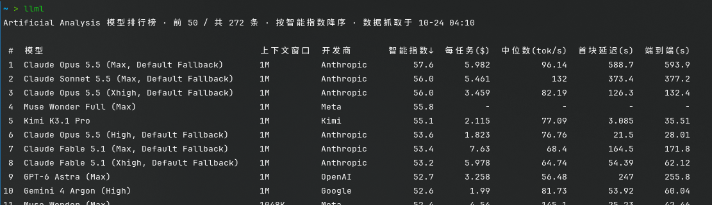

# llml

[Artificial Analysis](https://artificialanalysis.ai/zh/leaderboards/models) 模型排行榜命令行工具：抓取网页排行榜数据，以对齐表格或 JSON 打印，支持筛选、排序与本地缓存。



## 功能

- 默认输出：模型、上下文窗口、开发商、智能指数、每任务成本、输出速度、首块延迟、端到端响应
- `--full` 打印全部列
- 关键词筛选
- `-s <键> [asc|desc]` 按任意数值列排序
- `--json` 输出 JSON（配合 `--full` 输出全部字段）
- 输出格式自适应：终端里打印表格，被管道/重定向时默认输出 JSON；`--tui` 强制表格
- 数据本地缓存 6 小时

## 安装

```sh
go build -o llml ./cmd/llml
```

需要访问 artificialanalysis.ai；如需代理，设置 `HTTPS_PROXY` 环境变量。

## 用法

```sh
llml                         # 智能指数降序，前 50 条（--full 时默认 25 条）
llml -n 0                    # 全部
llml -n 10 claude deepseek   # 前 10 条，名称含 claude 或 deepseek
llml --full -n 5             # 全部列，两行一组
llml -s speed desc           # 按输出速度降序
llml -s cost asc             # 每任务成本升
llml --json -n 3 gemini      # JSON 输出，配合 jq 使用
llml -n 5 --tui              # 管道/重定向场景下强制表格输出
llml --no-cache              # 忽略缓存强制抓取并刷新
```

flag 可以写在关键词之前或之后（如 `llml claude --json`）。

排序键支持完整字段名与别名（大小写不敏感）：

| 字段 | 别名 |
| --- | --- |
| intelligenceIndex（智能指数） | `index` |
| contextWindowTokens（上下文窗口） | `ctx` |
| intelligenceIndexCostPerTask（每任务成本） | `cost` |
| medianOutputTokensPerSecond（输出速度） | `speed` |
| medianTimeToFirstTokenSeconds（首块延迟） | `ttft` / `latency` |
| medianEndToEndResponseTimeSeconds（端到端响应） | `e2e` / `endtoend` |
| 每百万 token 输入 / 输出价格 | `pricein` / `priceout` |
| 基准分数 | `hle` / `gpqa` / `mmmupro` |

## 许可证

[MIT](LICENSE)
